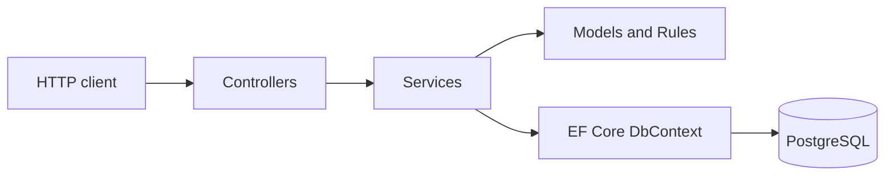

# MiniBank

A C#/.NET backend for exploring account balances, double-entry bookkeeping, and idempotent transfers with PostgreSQL.


**Personal learning and portfolio project. Deposits are simulated; no real money moves through this API. This is not a production banking system.**

[Overview](#overview) · [Architecture](#architecture) · [Idempotency](#transfer-idempotency) · [API](#api) · [Run locally](#run-locally) · [Limitations](#limitations-and-next-steps)

## Overview

Moving value between accounts requires more than updating two balance fields. The debit and credit must succeed together, the history must explain the balances, and a repeated request must not transfer the same amount twice.

MiniBank explores these problems through a small HTTP API backed by a relational database. It is also a hands-on transition from Java/Spring Boot experience to C# and ASP.NET Core, with an emphasis on understanding transaction boundaries and database guarantees.

## Technology stack

| Technology | Role |
| --- | --- |
| C# / .NET 10 | Application code, asynchronous I/O, and decimal arithmetic |
| ASP.NET Core | Controllers, dependency injection, validation, and HTTP responses |
| Entity Framework Core 10 | Persistence, change tracking, and migrations |
| Npgsql EF Core provider | PostgreSQL integration |
| PostgreSQL 17 | Transactions, row and advisory locks, constraints, and ledger triggers |
| Docker / Docker Compose | Local PostgreSQL container; a separate API Dockerfile is included |
| ASP.NET Core OpenAPI | OpenAPI JSON document in the Development environment |

Package versions are defined in [MiniBank.Api.csproj](MiniBank.Api/MiniBank.Api.csproj). There is no Swagger UI configured.

## Implemented features

- Create accounts with unique account numbers and an initial balance of zero.
- List public accounts and retrieve an account by ID.
- Make simulated deposits through an internal clearing account.
- Transfer between accounts with balance validation and atomic debit/credit updates.
- Record financial operations and their paired ledger entries.
- Enforce monetary precision, ledger consistency, and history immutability through application rules and database constraints/triggers.
- Reuse completed transfers through an idempotency key, with conflict detection for changed request data.
- Return validation, missing-account, and business-conflict errors through HTTP responses.

## Architecture

One ASP.NET Core application follows **Controller → Service → DbContext**. Services coordinate transactions; domain models apply financial rules. DTOs and mappers define the public response shape.



| Directory | Responsibility |
| --- | --- |
| `Controllers/` | Routes, request binding, and HTTP status mapping |
| `Service/` | Account workflows, transaction boundaries, locks, and idempotency |
| `Models/` and `Rules/` | Accounts, operations, ledger entries, monetary validation, and hashing |
| `Data/` and `Migrations/` | EF mappings, schema history, and PostgreSQL invariants |
| `DTOs/` and `Mappers/` | Request/response contracts and entity-to-response mapping |

Source identifiers and API field names remain in Portuguese. The examples below use the actual contract.

## Financial engine

Each deposit or transfer creates one operation and two entries of equal value: a debit and a credit. In this credit-normal subledger, credits increase account balances and debits reduce them.

| Operation | Debit | Credit |
| --- | --- | --- |
| Transfer | Source account | Destination account |
| Simulated deposit | Internal clearing account | Receiving account |

Only the clearing account can hold a negative balance. Migrations provision it, public account queries hide it, and clients cannot select it directly. Its ID can still appear in deposit response entries.

Amounts use C# `decimal` and PostgreSQL `numeric(18,2)`. They must be positive, within `9999999999999999.99`, and represent whole cents. Fractions of a cent are rejected rather than silently rounded.

The service opens a `READ COMMITTED` transaction and locks both accounts with `SELECT ... ORDER BY "Id" FOR UPDATE`. It checks the balance after acquiring the locks, then saves balances, the operation, and ledger entries together. Transfers also save their idempotency record in that transaction.

The migrations install deferred constraint triggers that check balanced entries and agreement between balances and the ledger at commit. Other triggers reject updates and deletes to financial operations and entries. This is a focused subledger model, not a complete bank chart of accounts.

## Transfer idempotency

`POST /api/transferencias` requires an **`Idempotency-Key`** header: a nonblank string of at most 128 characters. Use a new key for each intended transfer and keep that key when repeating the request.

1. Validate the request and generate a SHA-256 hash from the source ID, destination ID, and amount. Invariant formatting makes `10`, `10.0`, and `10.00` equivalent.
2. Acquire a PostgreSQL transaction-scoped advisory lock derived from the key, before locking any accounts.
3. Look up the full key and compare the stored request hash.
4. For a new key, execute the transfer and commit the idempotency record with its financial effects.

| Key state | Outcome |
| --- | --- |
| New key, valid transfer | Execute and return `200 OK` |
| Existing key, identical data | Return `200 OK` with the original operation ID, timestamp, and entries |
| Existing key, different valid transfer data | Return `409 Conflict` without another transfer |
| Missing, blank, or oversized key | Return `400 Bad Request` |

The lock order is **key → accounts ordered by UUID → commit**. A separate lookup after acquiring the key lock can see the preceding transaction's committed result. The UNIQUE index on the key remains an additional safeguard: its specific duplicate-key error is handled after disposing of the failed transaction and clearing tracked entities, before reading the confirmed operation.

Only successful transfers retain a key. Once a transfer commit begins, HTTP cancellation does not cancel that commit. A database connection failure can still leave the outcome unknown to the client; repeat the same key and data to resolve it. There is no automatic transaction retry.

**Concurrency protection is implemented, but concurrent requests, duplicate-key recovery, and connection loss during commit still require integration testing against PostgreSQL.** Deposits are not idempotent. Keys are global and have no expiration policy.

## API

Local base URL: `http://localhost:5032` with the `http` launch profile.

| Method | Route | Purpose | Success |
| --- | --- | --- | --- |
| `POST` | `/api/contas` | Create an account | `201 Created` |
| `GET` | `/api/contas` | List public accounts | `200 OK` |
| `GET` | `/api/contas/{id}` | Get an account and balance | `200 OK` |
| `POST` | `/api/contas/{id}/depositos` | Make a simulated deposit | `200 OK` |
| `POST` | `/api/transferencias` | Transfer with an idempotency key | `200 OK` |

### Create and fund accounts

Create two accounts, using `demo-001` and `demo-002` as their numbers. Save the IDs returned by the API; clients do not choose account IDs or starting balances.

```http
POST /api/contas
Content-Type: application/json

{"numero":"demo-001"}
```

Replace `<source-id>` with the first account's returned UUID. Execute this deposit once: repeating it adds funds again.

```http
POST /api/contas/<source-id>/depositos
Content-Type: application/json

{"valor":100.00}
```

### Transfer and repeat

Replace both ID placeholders with the created accounts' UUIDs.

```http
POST /api/transferencias
Content-Type: application/json
Idempotency-Key: demo-transfer-001

{
  "contaOrigemId":"<source-id>",
  "contaDestinoId":"<destination-id>",
  "valor":25.50
}
```

Successful financial responses contain `id`, `tipo`, `contaDebitoId`, `contaCreditoId`, `valor`, `dataUtc`, and `lancamentos`. Each entry contains `id`, `contaId`, `natureza`, and `valor`; debit precedes credit.

Repeat the exact transfer with the same key: expect the original operation and no additional balance change. Then change `valor` to `30.00` while retaining the key: expect `409 Conflict`. After the original transfer and its repetition, the source and destination should hold `74.50` and `25.50`, assuming no other operations.

```http
GET /api/contas
Accept: application/json
```

Invalid financial input returns `400`; missing accounts return `404`; insufficient funds, balance-limit violations, and conflicting idempotency data return `409`. Duplicate account numbers also return `409`.

Use [MiniBank.Api.http](MiniBank.Api/MiniBank.Api.http) in an HTTP-file-compatible editor for the full manual sequence. [MOTOR_FINANCEIRO.md](MOTOR_FINANCEIRO.md) contains more detailed design notes and simultaneous-request commands in Portuguese; those examples are validation instructions, not test results.

## Run locally

### Prerequisites

- .NET **10 SDK**.
- Docker Engine or Docker Desktop with Docker Compose support.
- Git and a terminal; the commands below use Bash on Linux, macOS, or WSL.
- Access to NuGet for package restore and EF CLI installation.

### Start PostgreSQL

```bash
git clone https://github.com/Farcicdev/MiniBank.git
cd MiniBank
docker compose up -d postgres
docker compose exec postgres pg_isready
```

Wait until PostgreSQL reports that it is accepting connections. The [Compose file](compose.yaml) maps host port **5433** to container port **5432** and stores data in a named volume. It starts only PostgreSQL; run the API on the host with the SDK below. See the [Docker Compose command reference](https://docs.docker.com/reference/cli/docker/compose/up/) for startup options.

The Compose configuration contains development-only database settings. Keep this environment isolated for local use; do not reuse its credentials in a deployed environment.

### Configure the connection

Set `ConnectionStrings__DefaultConnection` in the terminal used for both migrations and the API. Replace all placeholders with the local database settings from `compose.yaml`, or the settings of your own PostgreSQL instance. The example deliberately contains no credentials.

```bash
export ConnectionStrings__DefaultConnection='Host=localhost;Port=5433;Database=<database>;Username=<username>;Password=<password>'
```

For PowerShell, use this assignment instead; the subsequent `dotnet` and `docker` commands are the same:

```powershell
$env:ConnectionStrings__DefaultConnection = 'Host=localhost;Port=5433;Database=<database>;Username=<username>;Password=<password>'
```

The double underscore maps to the nested ASP.NET Core configuration key. See [environment-variable configuration](https://learn.microsoft.com/en-us/aspnet/core/fundamentals/configuration/?view=aspnetcore-10.0). Keep actual connection strings out of version control and shared terminal output. The application does not automatically load a `.env` file.

### Build, migrate, and start

```bash
dotnet restore
dotnet build --no-restore
```

Apply the existing migrations using the next section, then start the API in the same configured terminal:

```bash
dotnet run --project MiniBank.Api --launch-profile http
```

The API listens at `http://localhost:5032`. In Development, the OpenAPI JSON document is available at `/openapi/v1.json`. An HTTPS profile is also included in `launchSettings.json`; it requires a suitable local development certificate.

Use `Ctrl+C` to stop the API and `docker compose stop postgres` to stop the database while keeping its data.

## Apply EF Core migrations

The API does not apply migrations on startup. With PostgreSQL running and the connection variable set, install the CLI tool if needed:

```bash
dotnet tool install --global dotnet-ef --version 10.0.14
dotnet ef --version
```

If already installed, use `dotnet tool update --global dotnet-ef --version 10.0.14` to align it with the project's EF Core design package. Ensure the .NET global tools directory is on your `PATH`.

From the repository root:

```bash
dotnet ef migrations list --project MiniBank.Api --startup-project MiniBank.Api
dotnet ef database update --project MiniBank.Api --startup-project MiniBank.Api
```

The existing migrations create accounts and their unique numbers, install the financial engine and clearing account, and add the idempotency table. The financial migration also validates and converts pre-existing balances into opening ledger entries. It rejects incompatible data instead of silently correcting it.

For a database with existing data, review the migrations and back up the database before applying them. The financial migration takes an exclusive account-table lock and deliberately blocks automatic rollback through its `Down` method. Preserve applied migrations and use corrective migrations for future changes. `EnsureCreated` is not a substitute: it does not install the custom migration SQL for the ledger.

Command details: [EF Core CLI reference](https://learn.microsoft.com/en-us/ef/core/cli/dotnet).

## Limitations and next steps

| Current limitation | Next area of study |
| --- | --- |
| No automated test suite or concurrency integration tests | Test atomicity, competing transfers, duplicate requests, rollback, and ambiguous commit outcomes against PostgreSQL |
| No authentication or account ownership checks | Add authentication and authorization before considering any shared deployment |
| No statement, operation lookup endpoint, or reversal workflow | Add paginated history and compensating entries while preserving existing records |
| Deposits can be repeated; transfer keys are global and retained indefinitely | Define deposit semantics and key ownership/retention requirements |
| One clearing account serializes deposits; ledger checks aggregate account history | Measure database behavior before choosing performance changes |
| No dedicated observability setup or performance benchmarks | Add operational diagnostics and reproducible measurements |

There is no JWT authentication, Kafka, Redis, multi-currency support, or external financial integration. Database administrator privileges can bypass protections; database access hardening is outside the current implementation. External writers that ignore the lock order may introduce deadlocks.

A successful build and the documented spot-check of culture-independent hashing do not demonstrate correctness under concurrent database workloads. The local setup and manual API sequence should also be verified on a fresh environment.

## Technical learning

- Mapping Java/Spring Boot experience to ASP.NET Core dependency injection, controllers, and scoped EF Core contexts.
- Using `async`/`await`, cancellation tokens, records, nullable references, and controlled entity creation in C#.
- Distinguishing EF change tracking from a database transaction's commit boundary.
- Combining domain rules with database constraints to preserve financial invariants.
- Separating request identity from request content, and reasoning about retries after a lost response.
- Understanding how lock ordering, transaction isolation, and deferred checks affect concurrent writes.
